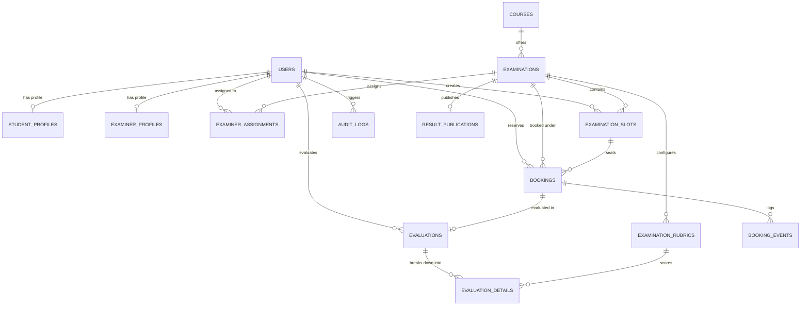

# Examination Management Portal (EMP)

An enterprise-grade, role-based academic examination management web application developed with **Python Flask**, **SQLite**, **Jinja2**, and **Bootstrap 5**. EMP streamlines examination scheduling, faculty slot assignment, duplicate-proof student booking, rubric-based evaluation, result publication, and audit tracking.

---

## 1. System Architecture & Entity-Relationship (ER) Model



### Table Responsibilities & Key Schema Design
| Table | Responsibility | Constraints & Enforcements |
|---|---|---|
| `users` | Core credentials, role (`admin`, `examiner`, `student`), activation state | Email & username unique, secure Werkzeug hash |
| `student_profiles` | Student roll number, department, degree program, contact | Unique `student_id_number`, FK to `users` |
| `examiner_profiles`| Department, designation, approval status (`pending`, `approved`, `rejected`)| FK to `users`, approval required before access |
| `courses` | Academic course syllabus codes and names | Unique `code`, soft archival if exams exist |
| `examinations` | Exam configurations, duration, max marks, timelines, status | Status state machine (`draft`, `slot_creation`, `booking_open`, `closed`, `completed`) |
| `examiner_assignments`| Faculty authorization to create slots and conduct an exam | Compound UNIQUE (`examination_id`, `examiner_id`) |
| `examination_rubrics` | Multi-criteria scoring benchmarks and weightage percentages | Sum of weights = 100%, max marks bounds |
| `examination_slots` | Date, time window, venue/link, capacity, booked seat counter | Overlapping check on same date, atomic counter |
| `bookings` | Student slot reservations and cancellation state | **Partial Unique Index**: 1 confirmed booking per student per exam |
| `booking_events` | Immutable historical trail of bookings, cancellations, reschedules | Records old/new slots, triggering user, reason |
| `evaluations` | Overall student exam score, examiner remarks, submission status | Unique `booking_id`, locking once submitted |
| `evaluation_details`| Marks awarded for each rubric criterion | Non-negative, cannot exceed criterion maximum |
| `result_publications`| Administrative gate for releasing results to students | Results invisible to students until published |
| `audit_logs` | Immutable audit log of administrative actions | Timestamp, actor, entity reference, IP, details |

---

## 2. Business Rules & Technical Enforcement

| Business Rule | Where Enforced | Technical Implementation |
|---|---|---|
| **BR-01: Role Isolation** | Flask Decorators (`@role_required`) | Server-side 403 Forbidden checks; session identity verified against SQLite users table on every request. |
| **BR-02: Exam Lifecycle** | `exam_service.py` | Validated state machine (`draft` -> `slot_creation` -> `booking_open` -> `closed` -> `completed`). |
| **BR-03: Slot Assignment** | `slot_service.py` | Examiner must have an active assignment in `examiner_assignments` to schedule slots. |
| **BR-04 & BR-05: Capacity & Overbooking** | `booking_service.py` | Atomic SQLite transaction (`BEGIN IMMEDIATE;`). Row lock checks `booked_count < capacity`. Slot updates to `full` automatically. |
| **BR-06: Automatic Slot Restoration** | `booking_service.py` | Cancellations decrement `booked_count` and restore `status = 'available'`. |
| **BR-07: Duplicate Booking Prevention** | Database + Service | Database partial unique index: `CREATE UNIQUE INDEX idx_unique_active_booking ON bookings(examination_id, student_id) WHERE status = 'confirmed';` |
| **BR-08: Booking Window** | `booking_service.py` | Strict validation against `booking_start` and `booking_end` ISO timestamps. |
| **BR-09: Evaluation Authorization** | `evaluation_service.py` | Examiner can evaluate only students booked into a slot assigned to that examiner. |
| **BR-10: Weighted Rubric Formula** | `rubric_service.py` | $\text{Final score} = \frac{\sum_i \left(\frac{\text{Marks awarded}_i}{\text{Criterion maximum}_i}\times \text{Weightage}_i\right)}{100} \times \text{Exam maximum marks}$ |
| **BR-11: Result Visibility** | `evaluation_service.py` | Database join with `result_publications WHERE is_published = 1`. Unapproved results remain completely hidden from students. |
| **BR-12: Audit & Rescheduling** | `booking_service.py` | Administrative reschedule moves booking, validates destination capacity, and records `booking_events`. |
| **BR-13: Historical Integrity** | `course_service.py` | Courses with linked exams are soft-archived (`is_active = 0`) instead of being destructively purged. |

---

## 3. Installation & Local Execution

### Prerequisites
- Python 3.10+ (Tested on Python 3.13)
- SQLite3

### Step 1: Install Dependencies
```bash
pip install -r requirements.txt
```

### Step 2: Programmatic Database Initialization (FR-AUTH-03)
Initialize the SQLite schema and create the programmatic administrator account:
```bash
python3 init_db.py
```

### Step 3: Seed Realistic Demonstration Data (Optional but Recommended)
Populate courses, approved examiners, pending examiners, exams across lifecycles, rubrics, slots, bookings, and evaluated results:
```bash
python3 seed_data.py
```

### Step 4: Run the Application
```bash
python3 run.py
```
Open your browser and navigate to: **`http://127.0.0.1:5000`**

---

## 4. Pre-configured Demonstration Accounts

All accounts created by `seed_data.py`:

| Role | Username | Password | Role & Purpose |
|---|---|---|---|
| **Administrator** | `admin` | `Admin@123` | Programmatically initialized system administrator |
| **Examiner (CS)** | `dr_sharma` | `Pass@123` | Approved Faculty (Computer Science) with scheduled slots |
| **Examiner (IT)** | `dr_priya` | `Pass@123` | Approved Faculty (Information Technology) with completed evaluations |
| **Examiner (EE)** | `dr_gupta` | `Pass@123` | Approved Faculty (Electrical & AI) |
| **Examiner (ME)** | `dr_bose` | `Pass@123` | Approved Faculty (Mechanical Engineering) |
| **Examiner (Pend)**| `prof_kapoor` | `Pass@123` | **Pending Approval** (Demonstrates approval lockdown workflow) |
| **Student (CS)** | `student_aryan` | `Pass@123` | Student with active bookings and certified published results |
| **Student (CS)** | `student_rohan` | `Pass@123` | Student with confirmed bookings |
| **Student (IT)** | `student_ananya`| `Pass@123` | Student with confirmed bookings |
| **Student (SE)** | `student_vikram`| `Pass@123` | Enrolled student ready to browse and book |
| **Student (EE)** | `student_kabir` | `Pass@123` | Enrolled in Electrical Engineering (EE102) |
| **Student (ECE)**| `student_pooja` | `Pass@123` | Enrolled in Electronics & Communication |
| **Student (DS)** | `student_meera` | `Pass@123` | Enrolled in Data Science & Analytics (DS205) |
| **Student (AI)** | `student_rahul` | `Pass@123` | Enrolled in Artificial Intelligence & ML |
| **Student (Mech)**| `student_arjun` | `Pass@123` | Enrolled in Mechanical Engineering (ME302) |
| **Student (Bio)**| `student_sneha` | `Pass@123` | Enrolled in Biotechnology & Bioinformatics |
| **Student (Civil)**| `student_tanvi`| `Pass@123` | Enrolled in Civil & Environmental Engineering |

---

### Step 5: Run Simultaneous Multi-Role Concurrent Testing (Separate Script)
To test and demonstrate all three roles (Administrator, Examiner, and multiple Students from different departments) running **simultaneously in parallel threads** with real-time logging:
```bash
python3 simulate_concurrent_roles.py
```
This script exercises real-time race conditions on slot capacity, duplicate booking rejection, administrative rescheduling, rubric evaluation, and instant student result publication.

---

## 5. Main User Workflows

### 5.1 Administrator Workflow
1. Log in as `admin`.
2. Manage courses (`/admin/courses`) and configure new courses.
3. Create examinations (`/admin/examinations`), configure duration, max marks, and dates.
4. Set evaluation rubric criteria on the exam details page.
5. Review examiner registrations (`/admin/examiners`) and approve pending faculty (e.g., `prof_kapoor`).
6. Assign faculty to examinations.
7. Advance lifecycle status to `slot_creation` and subsequently `booking_open`.
8. Monitor slots (`/admin/slots`) and bookings (`/admin/bookings`). Use **Reschedule** to resolve student timetable clashes.
9. Publish results (`/admin/evaluations`) once grading is complete.
10. Inspect immutable system logs (`/admin/audit-logs`).

### 5.2 Examiner Workflow
1. Register as a new examiner (`/register/examiner`). Observe the pending approval screen.
2. Once approved by administrator, log in as `dr_sharma` or `dr_priya`.
3. View assigned examinations (`/examiner/examinations`).
4. Create examination slots (`/examiner/slots/create`) with date, time, venue, and seat capacity.
5. Inspect the booked student roster for a slot (`/examiner/slots/<id>/roster`).
6. Click **Evaluate** on a booked student:
   - Enter marks against each rubric criterion (validated: non-negative and $\le$ criterion maximum).
   - Enter criterion feedback and overall examiner remarks.
   - Save as draft or submit final evaluation. Once submitted, marks are locked.

### 5.3 Student Workflow
1. Register as a student (`/register/student`) or log in as `student_aryan`.
2. Browse upcoming examinations (`/student/examinations`) with course and keyword search.
3. View available time slots for an exam (`/student/examinations/<id>/slots`).
4. Book an available slot. (Attempting to book a second slot for the same exam is blocked by duplicate booking rules).
5. View confirmed bookings (`/student/bookings`). Cancel an active booking before the deadline to release capacity.
6. View published scores and rubric criteria breakdown (`/student/results`).

---

## 6. Automated Verification Test Suite

The test suite thoroughly verifies role isolation, concurrent booking transactions, capacity enforcement, duplicate booking prevention, rubric calculation formulas, evaluation locking, and result visibility:

```bash
pytest -v tests/
```

### Test Suite Summary (14 Passed, 100% Pass Rate):
- `tests/test_auth.py`:
  - `test_admin_created_programmatically` (FR-AUTH-03)
  - `test_student_registration_and_login` (FR-AUTH-01/02)
  - `test_examiner_pending_approval_lockdown` (FR-AUTH-04/05)
  - `test_role_isolation_enforcement` (BR-01)
- `tests/test_booking_concurrency.py`:
  - `test_slot_capacity_and_overbooking_prevention` (BR-05/06)
  - `test_duplicate_booking_prevention` (BR-07)
  - `test_cancellation_restores_capacity_and_allows_rebooking` (BR-06, FR-ST-06)
- `tests/test_evaluation_rubric.py`:
  - `test_rubric_weighted_scoring_formula` (BR-10)
  - `test_marks_validation_and_bounds` (FR-EX-08)
  - `test_examiner_slot_authorization` (BR-09)
  - `test_result_visibility_only_after_publication` (BR-11, FR-ST-09)
- `tests/test_lifecycle.py`:
  - `test_examiner_slot_overlap_prevention` (Slot service overlap checks)
  - `test_admin_rescheduling_and_audit_trail` (BR-12)
  - `test_course_archival_when_dependencies_exist` (BR-13)

---

## 7. AI / LLM Assistance Declaration

In accordance with Section 12 of the Examination Management Portal Product Requirements Document (PRD):

* **Extent of Assistance:** AI assistance (Antigravity Assistant, Google DeepMind) was utilized during the project lifecycle for:
  - Drafting and refining database schema definitions and foreign key constraints in `app/schema.sql`.
  - Scaffolding the Flask application factory, service layers, and Jinja2 Bootstrap 5 templates.
  - Designing parameterized unit and concurrency test cases in `pytest`.
  - Formulating transactional queries for capacity checking and duplicate booking prevention.
* **Student Understanding:** All architectural decisions, SQLite transactions, role-based decorators, weighted rubric calculations, and business rules were thoroughly reviewed, tested, and validated to ensure complete understanding and readiness for defense during the viva examination.
=======
# examination-management-portal
>>>>>>> 85871994136ab4f7cb11579c886981d7a4adcdaf
